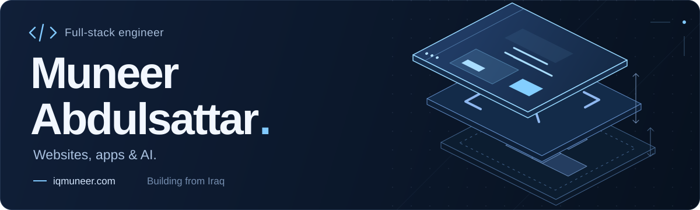

# 💫 About Me

**I'm Muneer Abdulsattar — a full-stack engineer based in Iraq.**

I build websites, web and mobile apps, and AI tools that help businesses grow.
Building real projects since 2022, in Arabic and English.

- 🏦 **Currently:** Web Developer at **Qi** · August 2024–present
- 💼 **Previously:** Front-End Developer at **Aswar** · August 2023–August 2024
- 🛠️ **What I build:** Business websites, custom systems, mobile apps, AI chatbots, and automations
- ⚡ **What I care about:** Performance, accessibility, security, and a great user experience
- 🌍 **Languages:** Arabic, English, and French · Working remotely from Iraq

## 🌐 Socials

## 🚀 Featured Work

- 📈 **[Wick Arabia](https://wickarabia.com)** — Trading education, market insights, and personalized learning dashboards.
- 🕋 **Addaah** — Arranging and tracking Umrah for loved ones, with photo and video documentation.
- 🤖 **Qi Wiyakum** — Helped build an AI-powered platform for creating applications for SuperQi.
- 🏦 **Rafidain Automation & Gini Gold** — Banking workflow automation and a miniapp with Qi wallet payments, built at Qi.

[Explore my work at iqmuneer.com](https://iqmuneer.com/about)

# 💻 Tech Stack

### 🎨 Frontend

### 📱 Mobile

### 🏗️ Backend & Data

### 🤖 AI Tools & Integration

- 💬 **AI chatbots:** Website and WhatsApp assistants that answer from business information in Arabic and English.
- 🧠 **AI features:** Smart search, document summaries, content generation, and data extraction.
- 🔗 **Connected workflows:** Lead classification, reply drafting, and integrations with CRMs, Google Sheets, and existing systems.

### 🔄 State Management & Tools

# 📊 GitHub Stats

## 🏆 GitHub Trophies

---

### 💬 Have a project in mind?

